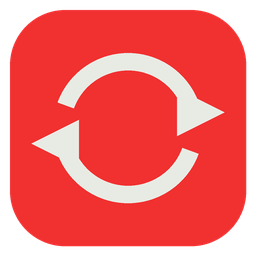
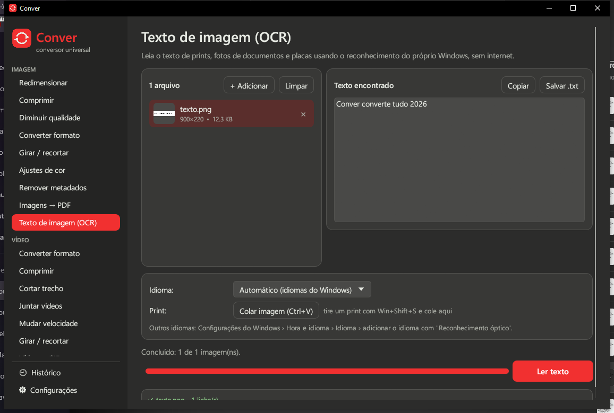
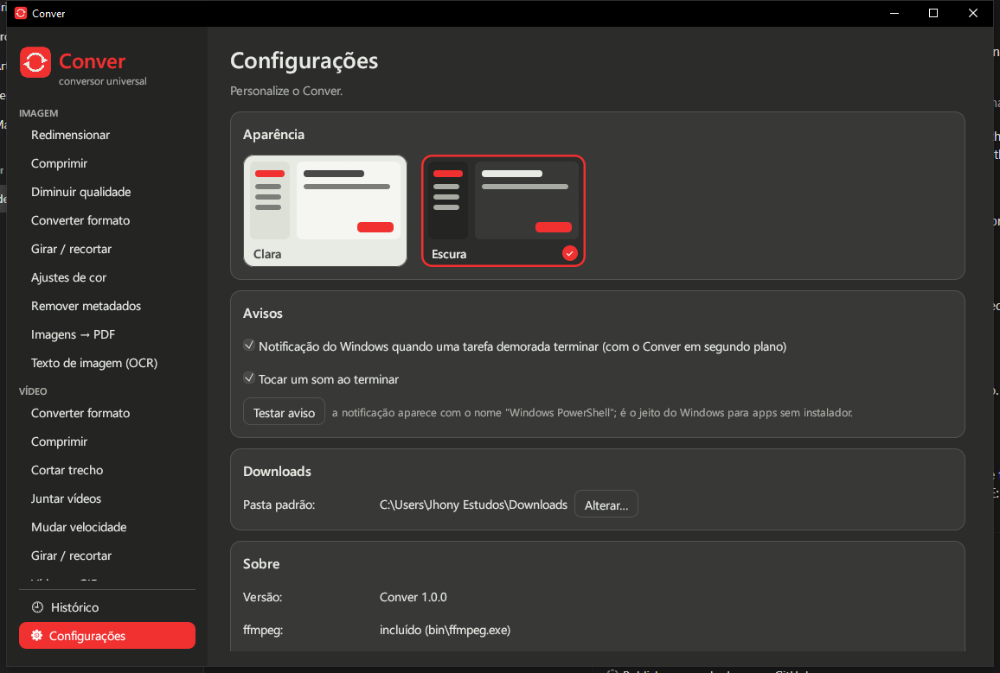
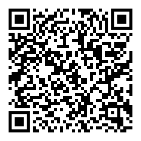

<p align="center">
  
</p>

<h1 align="center">Conver</h1>

<p align="center">
  <b>Conversor universal para Windows</b> — imagens, vídeos, áudios, PDFs e downloads num só programa, rápido e sem anúncios.
</p>

<p align="center">
  <a href="https://github.com/JhonyGoncalves/conver/releases/latest"><b>⬇ Baixar a versão mais recente</b></a>
  &nbsp;•&nbsp;
  <a href="#apoie-o-projeto">💚 Apoiar com Pix</a>
</p>



## Download

Na página de [releases](https://github.com/JhonyGoncalves/conver/releases/latest) há duas opções:

| Arquivo | Para quem |
|---|---|
| `Conver-x.y.z-instalador.exe` | Instala o Conver no seu usuário (não pede administrador), cria atalhos e pode adicionar **"Abrir com Conver"** ao menu do botão direito. |
| `Conver-x.y.z-portatil.zip` | Não instala nada: extraia em qualquer pasta (ou pendrive) e abra o `Conver.exe`. As configurações ficam na própria pasta. |

Requisitos: Windows 10 ou 11, 64 bits. O FFmpeg, o yt-dlp e o modelo do removedor de fundo já vêm junto — não é preciso instalar mais nada.

> **Aviso do Windows SmartScreen:** como o Conver é novo e não tem assinatura digital paga, o Windows pode mostrar "O Windows protegeu o computador". Clique em **Mais informações → Executar assim mesmo**. Os arquivos de cada versão têm a soma SHA-256 publicada na release, para você conferir.

## O que o Conver faz

**Imagem**
- **Ampliar com IA** (2× ou 4×, Real-ESRGAN): fotos pequenas, prints e imagens antigas sem borrar
- **Remover fundo** com IA, no próprio computador e sem internet: fundo transparente (PNG) ou de uma cor, borda definida ou suave
- Redimensionar (porcentagem ou pixels), comprimir, diminuir qualidade e converter entre PNG, JPG, WEBP, BMP, GIF, TIFF e ICO
- Girar, espelhar e recortar (1:1, 4:3, 16:9, 9:16…)
- Ajustes de cor: brilho, contraste, saturação, preto e branco, sépia
- Remover metadados (EXIF, localização GPS) sem perder qualidade
- Juntar imagens num PDF
- **Texto de imagem (OCR)** com o reconhecimento do próprio Windows, sem internet — inclusive colando um print (Win+Shift+S)
- Prévia do resultado antes de salvar

**Vídeo**
- Converter (MP4, MKV, AVI, MOV, WEBM, FLV, WMV, GIF, MP3) e comprimir (por nível ou pelo tamanho final em MB)
- Cortar trecho, juntar vídeos, mudar velocidade (0,25× a 4×)
- Girar e recortar para 9:16 (Reels/TikTok), 1:1, 4:5 e 16:9
- Vídeo → GIF de um trecho, queimar legenda (.srt/.ass/.vtt), música de fundo
- Remover o áudio ou extrair frames
- **Gravar a tela** (inteira, uma janela ou uma área) em MP4, com ou sem microfone, com prévia ao vivo do que vai ser gravado

**Áudio**
- Gravador de áudio (microfone) em MP3, WAV ou M4A, com faixa de áudio e medidor de nível ao vivo (mostra quando o som estoura) e teste do microfone antes de gravar
- **Transcrever / legendar** com o Whisper, sem internet: fala → texto (.txt) e legendas (.srt/.vtt), em dezenas de idiomas
- **Separar voz e instrumental** com IA (karaokê ou só a voz)
- Converter (MP3, WAV, FLAC, OGG, M4A, OPUS), cortar, juntar, normalizar volume e comprimir

**PDF**
- Juntar PDFs e dividir (páginas como `1-3, 7` ou uma página por arquivo)
- **Comprimir PDF**, **PDF → imagens** (PNG/JPG), **proteger com senha** e **tirar a senha**
- **PDF pesquisável (OCR)**: o texto de PDFs escaneados passa a poder ser pesquisado e copiado

**Downloads**
- YouTube, YouTube Music, TikTok, Instagram, X/Twitter, Facebook, Dailymotion, SoundCloud e centenas de outros sites (via [yt-dlp](https://github.com/yt-dlp/yt-dlp))
- MP4 ou MP3 com escolha de qualidade, playlists, vários links de uma vez, legendas e capa
- Login do navegador para sites que pedem conta
- Botão para atualizar o yt-dlp quando algum site mudar

**Ferramentas**
- Informações do arquivo (resolução, duração, codecs, câmera, GPS…)
- Pasta vigiada: converte automaticamente tudo que cair numa pasta
- Renomear em lote (com prévia e desfazer)
- Gerador de QR Code
- Histórico de conversões e downloads
- **Predefinições**: salve suas configurações favoritas (ex.: "WhatsApp até 16 MB") e use com um clique

**No dia a dia**
- **Busca de ferramentas** (Ctrl+F): ache pelo que você quer fazer ("cortar", "tirar fundo", "youtube"), não só pelo nome exato
- Arraste arquivos para a janela (ou para o ícone do Conver) e eles vão para a ferramenta certa
- "Abrir com Conver" no menu do botão direito
- **20 idiomas** (Configurações → Idioma): português, inglês, chinês, espanhol, árabe, francês, russo, indonésio, urdu, alemão, japonês, vietnamita, turco, hauçá, coreano, italiano, persa, suaíli, polonês e ucraniano
- Tema claro e escuro, aviso com som e notificação ao terminar tarefas longas
- Avisa quando sai uma versão nova e **se atualiza sozinho** com um clique (baixa, confere a assinatura, instala e reabre)



## Fluxos de automação (nodes)

Na seção **Automação**, você monta um fluxo ligando nodes num quadro: o resultado de um vai para o próximo
(ex.: *fotos → remover fundo → IA confere o recorte → aprovadas numa pasta, o resto em outra*). Todas as
ferramentas do Conver viram nodes, além de entrada, texto, filtro e "Salvar em pasta". Os nodes de IA usam a API
que você configurar (Anthropic/Claude ou qualquer API compatível com a da OpenAI, inclusive Ollama no próprio PC):

- **IA: instrução** — descrever imagens, resumir transcrições, escrever legendas, traduzir… (a resposta segue
  adiante como texto e pode ser salva como .txt, .md, .srt…)
- **IA: avaliar** — confere cada arquivo contra um critério e manda para a saída "sim" ou "não"

Os fluxos ficam salvos e também rodam pela linha de comando (`conver-cli flow_run --name "Meu fluxo" fotos\*`)
e pelo MCP, onde agentes de IA podem criar e editar fluxos (`flow_node_types`, `flow_save`, `flow_run`).

## Automação: linha de comando e agentes de IA (MCP)

Tudo o que o Conver faz também funciona sem abrir a janela, pelo `conver-cli.exe` (fica ao lado do `Conver.exe`):

```powershell
conver-cli list                                        # todas as ferramentas
conver-cli help video_compress                         # opções de uma ferramenta
conver-cli image_convert fotos*.png --format webp
conver-cli video_compress aula.mp4 --target_mb 50 --resolution 720p
conver-cli transcribe entrevista.mp3 --language pt --formats srt,txt
conver-cli preset "WhatsApp (vídeo até 16 MB)" video.mp4
conver-cli pdf_ocr digitalizado.pdf --json             # resultado em JSON
```

**Agentes de IA** (Claude Desktop, Claude Code, Cursor, VS Code e outros compatíveis com MCP) podem usar as mais de 40 ferramentas do Conver. Adicione ao arquivo de configuração de MCP do agente (o caminho certo aparece em Configurações → Automação, com um botão para copiar):

```json
{
  "mcpServers": {
    "conver": {
      "command": "C:\\Users\\voce\\AppData\\Local\\Programs\\Conver\\conver-cli.exe",
      "args": ["mcp"]
    }
  }
}
```

O servidor MCP usa stdio, informa o progresso das tarefas longas, aceita cancelamento e devolve os caminhos de cada arquivo gerado (e o texto, no OCR e na transcrição).

## Privacidade

Tudo é feito no seu computador. O Conver só acessa a internet quando você usa os downloads, quando atualiza o yt-dlp, na primeira vez que usa a transcrição ou a separação de voz (para baixar o modelo de IA, conferindo a assinatura) e, se a opção estiver ligada, para ver se há uma versão nova (uma consulta à API do GitHub). Não há telemetria.

Use os downloads apenas para conteúdos que você tem direito de baixar.

## Compilar a partir do código

O Conver é escrito em [Rust](https://www.rust-lang.org/) com a interface [egui](https://github.com/emilk/egui).

```powershell
# 1. ferramentas
winget install Rustlang.Rustup Gyan.FFmpeg JRSoftware.InnoSetup
# 2. coloque em Conver\bin o yt-dlp.exe (https://github.com/yt-dlp/yt-dlp/releases) e o onnxruntime.dll
#    (pasta lib do onnxruntime-win-x64-1.22.0.zip, https://github.com/microsoft/onnxruntime/releases/tag/v1.22.0)
#    e em Conver\modelos o silueta.onnx (https://github.com/danielgatis/rembg/releases/download/v0.0.0/silueta.onnx)
#    e o realesr-general-x4v3.onnx (exportado do .pth oficial do Real-ESRGAN v0.2.5.0)
#    e em Conver\bin\whisper o whisper-cli.exe e as DLLs do whisper-bin-x64.zip (whisper.cpp v1.9.2)
# 3. compile e gere a versão portátil e o instalador em dist\
powershell -ExecutionPolicy Bypass -File build.ps1
```

Para só rodar durante o desenvolvimento: `cargo run --release` (com `ffmpeg.exe` e `yt-dlp.exe` no PATH). Os testes ficam em `src/tests*.rs`: `cargo test --release -- --test-threads 1`.

### Estrutura

| Arquivo | O que tem |
|---|---|
| `src/main.rs` | Janela, menu lateral, configurações |
| `src/pages.rs`, `media_page.rs`, `extras*.rs` | As telas de cada ferramenta |
| `src/imaging.rs` | Imagens (redimensionar, comprimir, metadados, PDF…) |
| `src/video.rs`, `media.rs`, `media_extra.rs` | Vídeo e áudio com o FFmpeg |
| `src/download.rs` | Downloads com o yt-dlp |
| `src/pdf.rs`, `ocr.rs`, `info.rs`, `recorder.rs` | PDF, OCR, informações e gravador |
| `src/bgremove.rs`, `upscale.rs`, `separate.rs`, `ai.rs` | IA: remover fundo, ampliar, separar voz; ONNX Runtime e download de modelos |
| `src/transcribe.rs` | Transcrição com o whisper.cpp |
| `src/pdf_extra.rs` | Comprimir, senha, PDF → imagens e OCR de PDF |
| `src/screenrec.rs` | Gravação de tela |
| `src/ops.rs`, `cli.rs`, `presets.rs` | Núcleo das ferramentas (JSON), linha de comando, servidor MCP e predefinições |
| `src/i18n.rs`, `i18n/*.txt` | Idiomas: o texto em português do código é a chave; cada idioma tem linhas `número\|tradução` alinhadas com `i18n/keys.txt` |
| `src/integration.rs` | Menu do botão direito, atualizações, instância única |
| `installer/conver.iss` | Script do instalador (Inno Setup) |

## Apoie o projeto

O Conver é gratuito, sem anúncios e sem telemetria. Se ele te ajudou e você quiser contribuir com o desenvolvimento, aceito doações de qualquer valor por **Pix**:

<p align="center">
  
</p>

Também ajuda muito dar uma ⭐ no repositório, relatar problemas e sugerir ferramentas nas [issues](https://github.com/JhonyGoncalves/conver/issues).

## Licença

O código do Conver está sob a [licença MIT](LICENSE). Os downloads incluem o FFmpeg (GPL v3), o yt-dlp (Unlicense), o ONNX Runtime (MIT), o whisper.cpp (MIT) e os modelos silueta (MIT/Apache 2.0) e Real-ESRGAN (BSD-3) como componentes separados — veja [THIRD-PARTY.md](THIRD-PARTY.md).
