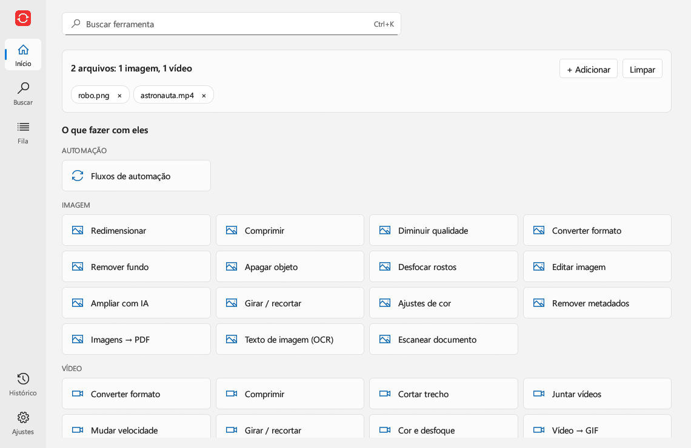
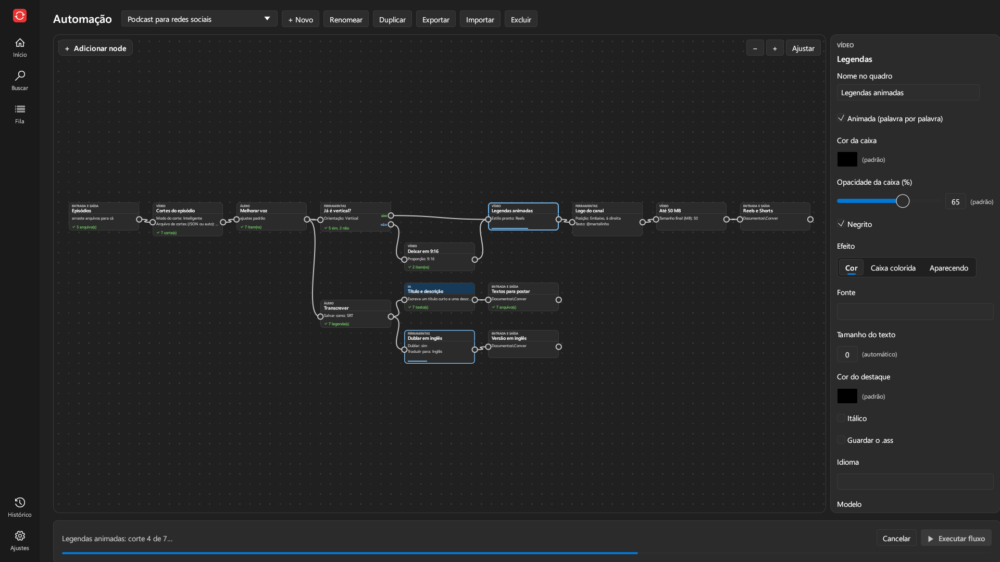
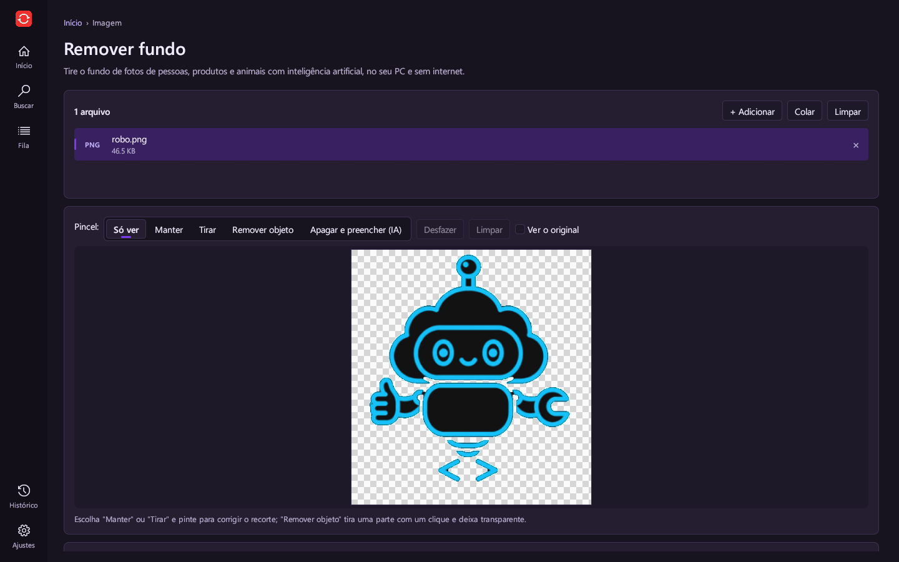
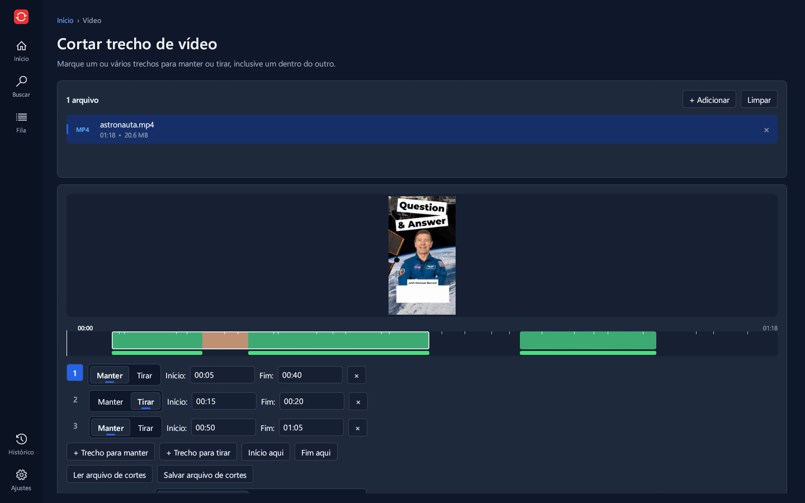
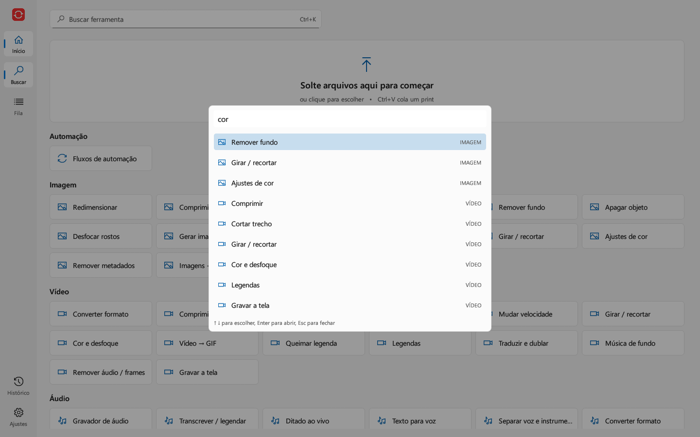
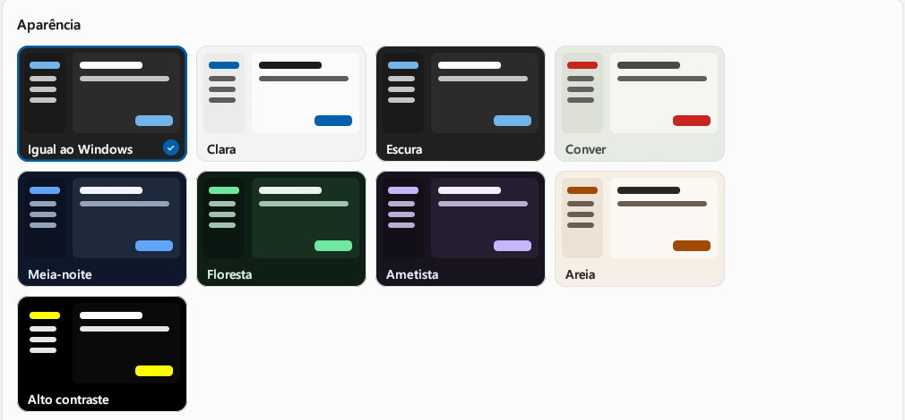

<p align="center">
  
</p>

<h1 align="center">Conver</h1>

<p align="center">
  <b>Conversor universal para Windows</b> — imagem, vídeo, áudio, PDF e downloads, com IA rodando no próprio PC.
  Gratuito, sem anúncios e sem telemetria.
</p>

<p align="center">
  <a href="https://github.com/JhonyGoncalves/conver/releases/latest"><b>⬇ Baixar a versão mais recente</b></a>
  &nbsp;•&nbsp;
  <a href="#apoie-o-projeto">💚 Apoiar com Pix</a>
</p>



## Como funciona

Solte, cole (Ctrl+V) ou escolha arquivos na tela inicial: aparecem só as ferramentas que servem para eles. **Ctrl+K**
acha qualquer ferramenta pelo nome ou pelo que você quer fazer ("tirar fundo", "aparar"). A **Fila** mostra as tarefas
de todas as ferramentas, e dá para começar várias ao mesmo tempo.

## Ferramentas

**Imagem**

| Ferramenta | O que faz |
|---|---|
| Remover fundo | Recorte com IA em fotos; em logos e desenhos, pela cor do fundo, mantendo o interior. Precisão, borda, pincel para manter ou tirar e remover um objeto com um clique |
| Apagar objeto | Pinte uma pessoa, texto ou marca d'água e a IA preenche com o fundo |
| Gerar imagem | Imagem a partir de uma descrição, na placa de vídeo, sem limite (DreamShaper, SDXL Lightning ou Z-Image Turbo) |
| Editar imagem | Escreva o que mudar ("deixe de noite"), pinte uma área e diga o que pôr ali, ou crie variações |
| Ampliar com IA | 2× ou 4× sem borrar (Real-ESRGAN) |
| Desfocar rostos | Desfoque, pixelado ou tarja, em fotos e vídeos |
| Texto de imagem (OCR) | Lê o texto de prints e fotos, sem internet |
| Escanear documento | Foto de papel vira documento reto e limpo, em imagem ou PDF |
| Básicas | Redimensionar, comprimir, converter (PNG, JPG, WEBP, BMP, GIF, TIFF, ICO), girar e recortar, ajustes de cor, remover metadados, imagens → PDF |

**Vídeo**

| Ferramenta | O que faz |
|---|---|
| Cortar trecho | Vários trechos para manter ou tirar, um dentro do outro, numa linha do tempo. Modo Inteligente: corte exato sem regravar o vídeo inteiro. Os cortes podem vir de um arquivo JSON |
| Legendas | Transcreve a fala (Whisper) e grava legendas paradas ou animadas palavra por palavra, com estilos prontos |
| Traduzir e dublar | Traduz as legendas com IA local e gera a dublagem com vozes naturais, no tempo da legenda |
| Gravar a tela | Tela inteira, monitor, janela ou área, com microfone e pausa |
| Básicas | Converter, comprimir (por nível ou tamanho final), juntar, velocidade, girar e recortar para 9:16 / 1:1 / 4:5, cor e desfoque, vídeo → GIF, queimar legenda, música de fundo, tirar áudio ou extrair frames |

**Áudio**

| Ferramenta | O que faz |
|---|---|
| Transcrever | Fala → texto e legendas (.txt, .srt, .vtt), em dezenas de idiomas, sem internet |
| Ditado ao vivo | O texto aparece enquanto você fala |
| Texto para voz | Narração com vozes naturais (Kokoro e Piper) |
| Separar voz e instrumental | Karaokê ou só a voz, com IA |
| Melhorar voz / Remover ruído | Som de podcast num clique; tira chiado e barulho de fundo, também em vídeos |
| Básicas | Gravador, converter (MP3, WAV, FLAC, OGG, M4A, OPUS), cortar, juntar, normalizar e comprimir |

**PDF:** juntar, dividir, organizar páginas com miniaturas, comprimir, PDF → imagens, senha (pôr e tirar), PDF
pesquisável (OCR) e tabelas para Excel, inclusive de PDFs escaneados.

**Downloads:** YouTube, TikTok, Instagram, X, SoundCloud e centenas de outros sites ([yt-dlp](https://github.com/yt-dlp/yt-dlp)),
em MP4 ou MP3, com playlists, legendas e capa.

**Automação:** fluxos por nodes (abaixo), pasta vigiada, predefinições, renomear em lote, marca d'água em lote,
linha de comando e servidor MCP para agentes de IA.

## Veja em ação

**Um fluxo de automação rodando:** episódios de podcast entram, são cortados pelo `.cortes.json` de cada um, têm a voz
melhorada, viram vídeos verticais com legenda animada e logo, comprimidos até 50 MB. Em paralelo, cada um é transcrito,
dublado em inglês e ganha título e descrição escritos pela IA.



| | |
|---|---|
|  |  |
| **Remover fundo** (tema Ametista) | **Cortar trecho** com corte dentro de corte (tema Meia-noite) |
|  |  |
| **Busca central** (Ctrl+K) | **Temas:** igual ao Windows, claro, escuro e mais seis |

## Download

| Arquivo | Para quem |
|---|---|
| `Conver-x.y.z-instalador.exe` | Instala no seu usuário (sem administrador), cria atalhos e pode pôr **"Abrir com Conver"** no botão direito |
| `Conver-x.y.z-portatil.zip` | Não instala nada: extraia e abra o `Conver.exe`. As configurações ficam na própria pasta |

Windows 10 ou 11, 64 bits. FFmpeg, yt-dlp e o modelo de remover fundo já vêm junto. Os modelos de IA maiores são
baixados só quando você usa a ferramenta (ou pelas Configurações), com a assinatura conferida.

> **SmartScreen:** sem assinatura digital paga, o Windows pode avisar "O Windows protegeu o computador". Clique em
> **Mais informações → Executar assim mesmo**. Cada release publica o SHA-256 dos arquivos.

O Conver se atualiza sozinho com um clique e está em 20 idiomas.

## Fluxos de automação

Ligue nodes num quadro: o resultado de um vai para o próximo. Toda ferramenta do Conver vira node, e há nodes de:

- **IA: instrução** — descrever, resumir, traduzir, escrever títulos; a resposta segue como texto ou vira arquivo
- **IA: avaliar** — manda cada arquivo para "sim" ou "não" conforme um critério
- **IA local: classificar** — sem internet: separa imagens, sons e textos por opções que você escreve
- **Condição** — por orientação, duração, tamanho, páginas ou se tem som
- **Renomear com padrão** — `{opção}_{data}_{n}`

Os nodes de IA usam a API que você configurar (Claude ou qualquer API compatível com a da OpenAI, inclusive Ollama).
Um fluxo pode rodar sozinho quando chega arquivo numa pasta ou num horário, guarda o histórico e repete só o que falhou.

## Cortes por arquivo JSON

Em **Cortar trecho**, solte um JSON junto com o vídeo, use **Ler arquivo de cortes** ou deixe `<nome do vídeo>.cortes.json`
ao lado dele:

```json
{
  "output": "separate",
  "mode": "smart",
  "cuts": [
    { "start": "0:10", "end": "1:00" },
    { "start": "0:20", "end": "0:30", "action": "remove" },
    { "start": "2:00", "end": "3:30" }
  ]
}
```

`start` é obrigatório; sem `end`, vai até o fim. `action`: `keep` (padrão) ou `remove`. `output`: `together` ou
`separate`. `mode`: `fast`, `smart` ou `precise`. Tempos em segundos ou como `1:30`.

## Linha de comando e agentes de IA (MCP)

Tudo funciona sem abrir a janela, pelo `conver-cli.exe`:

```powershell
conver-cli list                                        # todas as ferramentas
conver-cli help video_compress                         # opções de uma ferramenta
conver-cli video_compress aula.mp4 --target_mb 50 --resolution 720p
conver-cli media_trim podcast.mp4 --cuts_file auto --cut_mode smart
conver-cli flow_run --name "Meu fluxo" fotos\*
```

Agentes compatíveis com MCP (Claude Desktop, Claude Code, Cursor, VS Code…) usam as mais de 50 ferramentas e criam e
rodam fluxos. O caminho certo e um botão para copiar ficam em Configurações → Automação:

```json
{ "mcpServers": { "conver": { "command": "C:\\Users\\voce\\AppData\\Local\\Programs\\Conver\\conver-cli.exe", "args": ["mcp"] } } }
```

## Privacidade

Tudo roda no seu computador. O Conver só acessa a internet nos downloads, para atualizar o yt-dlp, para baixar um modelo
de IA na primeira vez que ele é usado, nos nodes de IA que usam a API que você configurou e, se ligado, para ver se há
versão nova. Não há telemetria. Use os downloads só para conteúdos que você tem direito de baixar.

## Compilar

Rust + [egui](https://github.com/emilk/egui). As ferramentas externas (FFmpeg, yt-dlp, ONNX Runtime, whisper.cpp, Piper,
stable-diffusion.cpp) e os modelos embutidos vão em `Conver\bin` e `Conver\modelos`; as versões estão em
[THIRD-PARTY.md](THIRD-PARTY.md).

```powershell
winget install Rustlang.Rustup Gyan.FFmpeg JRSoftware.InnoSetup
cargo run --release                                    # rodar
cargo test --release -- --test-threads 1               # testes
powershell -ExecutionPolicy Bypass -File build.ps1     # portátil e instalador em dist\
```

## Apoie o projeto

O Conver é gratuito, sem anúncios e sem telemetria. Se ele te ajudou, aceito doações de qualquer valor por **Pix**:

<p align="center">
  
</p>

Uma ⭐ no repositório, relatos de problemas e sugestões nas [issues](https://github.com/JhonyGoncalves/conver/issues)
também ajudam muito.

## Licença

Código sob a [licença MIT](LICENSE). Os downloads incluem o FFmpeg (GPL v3), o yt-dlp (Unlicense), o ONNX Runtime (MIT),
o whisper.cpp (MIT), o Piper (MIT, com o espeak-ng sob GPL v3), o stable-diffusion.cpp (MIT) e os modelos silueta
(MIT/Apache 2.0), Real-ESRGAN (BSD-3) e RNNoise como componentes separados — veja [THIRD-PARTY.md](THIRD-PARTY.md).
